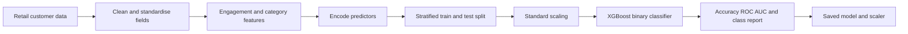

# Retail Customer Analytics and Marketing Prediction

> An applied retail analytics and machine learning project exploring mobile-shop customer characteristics, social media engagement and classification of existing versus first-time customers.

**Status:** XGBoost training script and saved model artifacts available. Streamlit user interface is a demonstration prototype, not a verified connection to the trained model.  
**Stack:** Python, pandas, scikit-learn, XGBoost, Plotly, Streamlit and joblib.

## Executive Summary

Retail businesses want to understand the characteristics of their customers and the marketing channels associated with their visits. This project uses mobile-shop customer data to investigate demographic, purchasing and social engagement features. It demonstrates an XGBoost classification workflow and presents a Streamlit prototype for exploring customer profiles.

The implemented prediction target is whether a customer **has purchased a mobile phone before**, not whether that customer will make a future purchase. This distinction matters: the existing model should not be described as a validated retention, conversion or future return predictor.

## Business Problem and Objectives

The project explores how observable customer attributes and engagement relate to customer history. Potential analytical applications include customer profiling, marketing channel evaluation and identifying segments for further research.

Objectives:

1. Explore the distribution of customer demographics, mobile brands and selling prices.
2. Analyse customer engagement with a retailer's Facebook presence.
3. Engineer useful categorical and engagement features.
4. Train a binary classifier to distinguish prior purchasers from first-time customers.
5. Evaluate discrimination using suitable classification metrics.
6. Prototype a user interface for inspecting customer characteristics and illustrative predictions.

## Data and Target Definition

The repository includes `data.csv` and derived datasets `df_clean_data.csv` and `df_with_new_features.csv`.

| Feature group | Example fields | Purpose |
| --- | --- | --- |
| Demographics | Age, gender, customer location | Customer characteristics |
| Product and price | Mobile name, selling price | Purchase context |
| Social engagement | Arrived via Facebook, follows Facebook page, heard of the shop | Marketing-related indicators |
| Target | `previous_customer` | Whether the customer had bought a mobile before |

The training script maps `previous_customer` to a binary target: **1 for previous purchasers and 0 for customers without a previous purchase**. Dataset provenance, observation dates, class proportions and sampling limitations need additional documentation. Price currency is not explicitly verified from the data description.

## Architecture and Workflow



A separate Streamlit prototype provides a customer information form and visualisations. Its current outputs are generated by manually defined rules, not the saved XGBoost model.

## Data Preparation and Feature Engineering

The training code in `app.py` renames input columns, standardises categorical text, builds an engagement score from three indicators and categorises engagement intensity and selling price. It applies label encoding to selected binary columns and one-hot encoding to other categorical features. It then performs a stratified 80/20 train/test split and applies a `StandardScaler` fitted on training data.

The current script fits some categorical transformations before the train/test split and does not persist a complete inference-ready preprocessing pipeline or feature schema. These aspects should be improved before deployment or use on new customer records.

## Machine Learning and Evaluation

The training script implements an `XGBClassifier` with 100 estimators, learning rate 0.1 and maximum tree depth 6. It calculates accuracy, ROC AUC and a classification report after evaluation on a held-out test split.

| Component | Evidence in repository | Status |
| --- | --- | --- |
| XGBoost training | `app.py` | Implemented in code |
| Model checkpoint | `xgboost_model.joblib` | Committed |
| Feature scaler | `scaler.joblib` | Committed |
| Accuracy and ROC AUC | Evaluation code | Values not independently reproduced |
| End-to-end production inference | Saved feature schema and model-backed UI | Not verified |

Accuracy alone is insufficient if customer classes are imbalanced. A reliable evaluation should also include precision, recall, F1, confusion matrix and an appropriate baseline. Any reported probability should be assessed for calibration before being used in customer decisions.

## Streamlit Demonstration

The separate `streamlit_app.py` displays customer inputs, engagement visuals, a probability-style gauge and illustrative marketing suggestions.

**Important:** Its `mock_prediction()` function uses fixed conditions for engagement and selling price. The feature importance chart and monthly customer trends are also hardcoded illustrative data. These displays must not be presented as measured results from the trained model or historical customer activity.

A future release should load the saved XGBoost model, apply the exact fitted feature transformation pipeline and generate evaluated predictions for supplied customer profiles.

## Repository Structure

```text
README.md
app.py                         # XGBoost training and export
streamlit_app.py               # Frontend demonstration with mock predictions
data.csv
df_clean_data.csv
df_with_new_features.csv
xgboost_model.joblib
scaler.joblib
requirements.txt
teslim-adeyanju-retail-pulse.ipynb
teslim-adeyanju-retail-pulse-note.ipynb
teslim_adeyanju_retail_pulse_updated.ipynb
... additional notebook copies
docs/
    legacy-readme.md
```

## Setup and Reproducibility

```bash
git clone https://github.com/TeslimAdeyanju/Retail-Marketing-Prediction.git
cd Retail-Marketing-Prediction
python3 -m venv .venv
source .venv/bin/activate
python -m pip install -r requirements.txt

# Run the modelling workflow
python app.py

# Launch the illustrative frontend
streamlit run streamlit_app.py
```

The dependency file is a large environment export rather than a minimal, tested runtime definition. The commands above have not been independently executed during this documentation revision.

**Caution:** Running `app.py` retrains and overwrites the root model and scaler artifacts. Review the dataset and code before executing it. The frontend currently does not use these trained artifacts for predictions.

## Business Interpretation

This project demonstrates how transaction context and marketing engagement can be converted into analytical features and used for customer-history classification. It does **not** establish that Facebook engagement causes repeat purchases or that the model predicts future retention. Those claims would require temporally appropriate data, a clearly defined future outcome and robust validation.

## Limitations and Next Steps

1. Document dataset provenance, sampling, date range and price currency.
2. Clarify when each feature became available relative to the target to prevent information leakage.
3. Fit and save the complete preprocessing pipeline, including encoded feature names.
4. Replace `mock_prediction()` with tested inference using the trained model.
5. Replace illustrative trend and feature-importance charts with measured results or label them clearly as examples.
6. Reproduce test metrics and add a confusion matrix, class-sensitive scores and calibration checks.
7. Compare the model against simple baselines and assess generalisation over time.
8. Consolidate duplicate notebooks and streamline dependencies.
9. If the business goal is **future customer return or conversion**, define that new target and retrain on appropriate longitudinal data.

## Responsible Use

The current classifier describes historical customer status using the available data. Do not use its outputs as a sole basis for customer treatment or consequential marketing decisions. Demographic features should be assessed for fairness, necessity and privacy implications.

## Author

**Teslim Adeyanju**  
[GitHub](https://github.com/TeslimAdeyanju) | [Portfolio](https://adeyanjuteslim.co.uk) | [LinkedIn](https://www.linkedin.com/in/adeyanjuteslimuthman)

[Original README archive](docs/legacy-readme.md)
